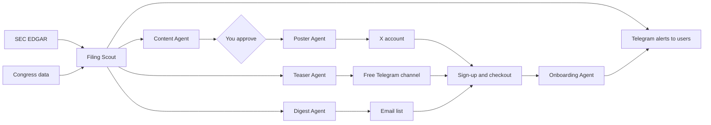

# Behind The Curtain — Marketing & Automation Strategy

First written Sep 29, 2026 · last updated Nov 15, 2026 · @Umer Saqib

## Where we are (Nov 15, 2026)

| Part | State |
| --- | --- |
| Web app: Telegram login, watchlists for ~6,100 US companies and all of Congress, company pages, alert history | Built |
| Filing Scout (agent 1): SEC Form 4 every 10 minutes, nightly catch-up, review hold for $50M+ trades | Built, tested on real filings and on Postgres |
| Notable score | Rebuilt from a backtest of 134,000 real trades (2023–2026); see `docs/backtest-2023-2026.md` |
| Pro options: skip pre-planned sales, notable trades from every company | Built; Pro is switched on by hand until payments exist |
| Congress trades | Code written, **untested**: needs a data licence (see Fix before launch #4) |
| Free-plan limits (3 names, alerts 24 hours late) | **Not built**: today every user gets unlimited instant alerts |
| Deployment, X account, payments, the other six agents | Not started |

Waiting on the owner: Telegram bot (via @BotFather), Railway account, a decision on Congress data, business
registration and payment-provider approval, a lawyer's view on the two legal questions, and an Anthropic API key
for the Content Agent.

## Executive summary

Behind The Curtain should launch as a $15/month personal alert service for US retail traders, grown mainly through a free X account that posts the most notable and newsworthy insider and Congress buys.

The product: a web app where you star the politicians and companies you care about, and a Telegram bot that pings you the moment one of them files a trade. Congress trades (House and Senate reports) and company insider trades (SEC Form 4) sit in one watchlist.

The market is proven but crowded. Quiver, Unusual Whales, Capitol Trades, TraderCongress and Autopilot already serve it. Behind The Curtain wins on one thing they do badly: fast, personal alerts inside Telegram, at a lower price, with a community on top. It also has one thing to point to that most trackers lack: its "notable" list follows rules tested on three years of real filings, instead of showing everything or guessing.

The plan has two parts. Part 1 is the selling strategy (who, what to say, where, what price, when). Part 2 is a set of small AI agents you build in Claude Code that do most of the daily marketing work for you, rolled out in three phases so you stay in control.

## Fix before launch

Five things will cause problems if they are not sorted out first.

**1. Skool cannot switch off access when someone cancels.** Skool has no official API, and its Zapier connection has no "member cancelled" trigger and no "remove member" action ([Zapier forum](https://community.zapier.com/how-do-i-3/sync-membership-access-between-skool-and-my-external-membership-website-49551), [unofficial API notes](https://github.com/ctala/skool-api-docs)). If Skool takes the payment, people who cancel keep getting Telegram alerts. Fix: take payment in the web app with a payment provider that sends cancel events. Then invite paying users into Skool automatically (Zapier can do "invite member"). Skool becomes the community, not the till.

**2. Congress trades are old news by the time they are public.** Members of Congress can take up to 45 days to report a trade. Company insiders must file Form 4 within 2 business days ([SEC filing example](https://www.sec.gov/Archives/edgar/data/1811972/000181197225000007/ex191insidertradingpolicy.htm)). So sell speed on filings ("you know within minutes of the filing"), never speed on the trade itself. Company insider alerts are the fresher, more useful half of the product.

**3. Pick a payment provider that accepts this product.** *(Updated Oct 2026 after checking the policies.)*
Paddle's acceptable use policy bans "investment or financial advice, including trading signals and strategies"
([Paddle AUP](https://paddle.com/support/aup)), and Polar bans "trading signals, or investment strategies"
([Polar acceptable use](https://polar.sh/docs/merchant-of-record/acceptable-use)). Lemon Squeezy's list doesn't
name trading ([Lemon Squeezy prohibited products](https://docs.lemonsqueezy.com/help/getting-started/prohibited-products)),
but it is moving its sellers to Stripe Managed Payments, Stripe's own merchant of record, available in Checkout
since April 2026 ([Stripe changelog](https://docs.stripe.com/changelog/dahlia/2026-04-22/managed-payments.md)).
Recommended order: (1) Stripe Managed Payments, (2) plain Stripe with Stripe Tax if Managed Payments says no
(you then register for EU VAT yourself; US sales tax only matters past each state's sales threshold), (3) Lemon
Squeezy as a backup. Budget for higher fees than first assumed: third-party reviews put Managed Payments at about
6.4% + $0.30 on a US card and 8% or more on international cards
([fee breakdown](https://dodopayments.com/blogs/stripe-managed-payments-fees-explained)); confirm on Stripe's
own pricing page. Whatever the provider, describe the product as software: "real-time alerts on public SEC and
Congress trade filings, for a watchlist you choose". Never call it signals, tips or advice, in the application or
on the site. Get written approval before building checkout.

**4. Congress data needs a commercial licence, and it costs more than planned.** *(Found Nov 2026.)* Quiver's
Hobbyist ($30 per month) and Trader ($75) API plans say "No Commercial Use Rights". Commercial use and
redistribution start at the Startup plan: $125 per month in the first year, then $250
([Quiver API pricing](https://api.quiverquant.com/pricing/)). The first version of this plan assumed $10. Options:

| Option | Cost | Tradeoff |
| --- | --- | --- |
| A. Launch with company insiders only; add Congress when about 20 Pro members cover the licence | $0 now | The fresher, backtested half of the product ships first; the X account can still post Congress trades by hand from the official House and Senate sites, which are free to read |
| B. Quiver Startup from day one | $125, later $250 per month | Congress alerts at launch, but the biggest fixed cost before any revenue |
| C. Read the official House and Senate disclosure sites ourselves | $0, more build work | No vendor licence; House reports are PDFs, so it is fragile and needs upkeep |

Recommended: A, and ask Quiver in writing what the Startup plan allows (alerts to paying users, posts on X).

**5. The Free plan is not built yet.** The pricing below says Free means 3 names and alerts 24 hours late. The
app does not enforce either, so today a free user gets what a Pro user pays for. Build the limits before any
public sign-ups.

## Target customer and positioning

The first customer is a US retail trader, 22–45, who already follows "Pelosi tracker"-style accounts on X and wants alerts on a few names, not a data terminal.

What they have in common:

- They trade individual stocks from a phone (Robinhood, Webull, Schwab) and already use Telegram or Discord for trading chatter.
- They find Quiver and Unusual Whales too complex or too expensive for what they need.
- They are motivated partly by anger ("politicians shouldn't beat the market") and partly by greed ("copy the smart money").

**Positioning line:** *The people with inside information have to show their trades. Behind The Curtain sends them to your phone.*

| Competitor | Price | What they do well | Where Behind The Curtain wins |
| --- | --- | --- | --- |
| [Capitol Trades](https://tradercongress.com/blog/how-to-track-congressional-stock-trades) | Free | Clean browsing of Congress trades | They have no real alerts; you do |
| [Quiver Quantitative](https://kapitol.ai/best-congress-stock-trackers) | Free / $25 per month | Deep data, backtests, API | Built for data people; you are built for phones |
| [Unusual Whales](https://barebone.ai/resources/best-apps-to-track-insider-congress-trades) | \~$40–60 per month | Options flow + Congress alerts | You cost a quarter of the price for the part most people want |
| [Capitol Gains](https://www.capitolgainsapp.com/) | Free / from $6.99 per month | Mobile app, watchlist push alerts | You add company insiders + Telegram + community |
| [Autopilot / Pelosi Tracker](https://www.salon.com/2025/03/17/pelosi-tracker-shows-us-how-to-trade-stocks-like-politicians/) | \~$100 per portfolio per year | Auto-copy trades into a brokerage | You leave the decision with the trader |

The honest gap you fill: nobody combines Congress + company insiders + a personal watchlist + Telegram delivery + a community at a mid price. That is the pitch.

## Messaging

Lead with one core pitch, then test three angles against each other on X and on the landing page.

**Core pitch:** Pick the politicians and CEOs you want to watch. The moment they file a trade, it lands in your Telegram. No dashboards to check.

| Angle | Hook example | Who it pulls in |
| --- | --- | --- |
| Outrage | "Congress keeps trading stocks they regulate. Watch every move." | Political, high-share audience; best for growth on X |
| Smart money | "When a director buys shares in their own S&P 500 company, you'll know within minutes." | Serious traders; best for paid conversion |
| Simplicity | "Star a name. Get a ping. That's it." | People put off by Quiver and Unusual Whales |

Rules for all copy:

- Report what was filed, never tell people to buy or sell. "Rep. X filed a $250K purchase of NVDA" is fine; "Buy NVDA now" is not.
- Always show the filing date next to the trade date, so nobody feels misled about timing.
- Keep the brand name front and centre. "Behind The Curtain" carries the "hidden moves made visible" idea on its own.
- Call a trade "notable", never a "signal", "tip" or "pick". Payment providers ban trading signals, and those words read as advice.
- Never promise or imply returns. The backtest numbers (for example "65% of notable buys rose within 6 months") stay out of ads and posts until a lawyer has approved the wording; the edge is modest and the test has known gaps.
- What you may say about the method: "Notable trades follow rules tested on 134,000 real filings from 2023 to 2026." That is a fact about the method, not a promise about results.
- Lead with buys. Sells did not predict anything in the backtest, so they go to people who starred the company, not onto X.

The smart-money hook changed after the backtest: buys by CEOs and very large buys did no better than average, while directors and officers buying at large S&P 500 companies did best. Hooks should match what the data supports.

## Channel strategy

X is the main channel; everything else feeds it or catches the people it brings in. This is the exact route the "Nancy Pelosi Stock Tracker" account took: it posts disclosures with short commentary and now has about 1.9 million followers ([X profile](https://x.com/pelositracker)).

| Rank | Channel | Why here | Owner |
| --- | --- | --- | --- |
| 1 | X (Twitter) account | Proven home of this audience; every new filing is free content | Content Agent + Poster Agent, you approve |
| 2 | Free public Telegram channel | Shows 1–2 delayed alerts a day as a sample; the paid bot gives the rest instantly | Teaser Agent |
| 3 | Email list from the landing page | Weekly "Top 5 filings" digest; the list you own if X changes its rules | Digest Agent |
| 4 | Reddit (r/stocks, r/wallstreetbets, r/investing) | Big audience, but hates self-promotion; share useful data posts, not ads | You, with drafts from the Content Agent |
| 5 | YouTube Shorts / TikTok | Short "Senator X just sold..." videos; add once X works | Later phase |
| 6 | Paid ads | Skip for now: financial ads face strict rules and your budget is small | — |

Two warnings for X. An earlier Pelosi tracker account was permanently suspended for spam ([SFGate](https://www.sfgate.com/national-politics/article/Nancy-Pelosi-viral-stock-trades-16826801.php)), so don't post dozens of near-identical automated posts. And under X's API pricing, a post with a link costs $0.20 versus $0.015 without one ([OpenTweet](https://opentweet.io/how-to/x-api-pay-per-use-explained)), so keep the link in your bio and post plain text.

Timely angle: Nancy Pelosi did not run again and leaves Congress when her term ends in early January 2027 ([CBS News](https://www.cbsnews.com/news/nancy-pelosi-former-house-speaker-retire-congress)), so there is room for a "who is the next Pelosi" story. A new Congress is sworn in on January 3, 2027, with new members and new committee seats: a natural moment for "meet the new traders" posts and for the first monthly ranking of the top-trading members. The app's nightly sync picks up the new members by itself.

### What the X account posts (decided Oct 2026, after the scoring backtest)

The backtest (`docs/backtest-2023-2026.md`) found about 9 notable insider trades a week, too few on their own
for an account that needs to post several times a day. Three kinds of post fill the feed, all **buys only**
(sells predicted nothing, and a stream of "CEO sold" posts reads as noise):

1. **Notable trades:** the scored list (officers and directors buying S&P 500 stocks, CEOs at the top 200).
   The only posts allowed to call a trade "notable". Never "signal", "tip" or "pick" (payment providers ban
   trading signals, and it reads as advice).
2. **Newsworthy buys:** facts that get attention whatever their score: insider buys of $1M+ by officers or
   directors, clusters of insiders buying together, and Congress purchases once the Quiver feed is live.
   These posts state the filing and nothing more. At most one post per stock per day.
3. **Fact-checked follow-ups:** "NVDA is up 30% since Nancy Pelosi's purchase, which we sent to our group on
   12 March." Built from our own sent-alert record, never from memory:
   - Measure from the **day we sent the alert** (what a member could have acted on). For Congress, also show the
     trade date, since members disclose up to 45 days late; never imply members bought at the trade-date price.
   - Use split- and dividend-adjusted closing prices, and show both dates in the post.
   - Losers exist too. To keep winner posts honest, publish a **track record page** listing every notable alert
     and its result, and link it from each follow-up. "Past results don't predict future results" goes on every one.
   - Needs: the alert log the Telegram sender already keeps, and a daily price source. Price data is a licensing
     question, not only a technical one: the cheap plans are for internal use (Tiingo's $50 per month commercial
     plan says you "may not display or share the data", [Tiingo pricing](https://www.tiingo.com/about/pricing)).
     Ask the vendor in writing whether posting our own "% change since a date" counts as display. There is no
     rush: a follow-up only makes sense months after an alert, so this can wait until after launch.

Roundups reuse the same data: a daily "biggest insider buys today" thread and the weekly top 10.

## Pricing and launch offer

Two plans, priced between the free trackers and Unusual Whales: Free, and Pro at $15 per month.

| Plan | Price | What you get |
| --- | --- | --- |
| Free | $0 | Follow 3 names, alerts delayed 24 hours, public Telegram channel *(limits not built yet)* |
| Pro | $15 per month or $120 per year | Unlimited follows, instant Telegram alerts, both Congress and company insiders, notable trades from every company, the option to skip pre-planned sales, weekly digest, Skool community |
| Founding member | $9 per month, locked for life | First 100 Pro subscribers only |

Why $15: Quiver Premium is $25 and Unusual Whales is around $40–60, while Capitol Gains starts at $6.99 ([Quiver](https://kapitol.ai/best-congress-stock-trackers), [Unusual Whales](https://barebone.ai/resources/best-apps-to-track-insider-congress-trades), [Capitol Gains](https://www.capitolgainsapp.com/)). $15 is an easy "yes" and still leaves room for a higher tier later.

What you keep per $15 sale: with Stripe Managed Payments at roughly 6.4% + $0.30 for a US card (see Fix before launch #3), about $1.25 goes in fees, and closer to $1.50–1.80 on an international card. On a $9 founding membership it is about $0.90. Skool's Hobby plan costs $9 per month ([Kourses](https://kourses.com/skool-pricing/)); because members join free by invite, Skool's 10% payment fee never applies.

The free plan is the growth engine: it gets people into Telegram, where the upgrade prompt lives. Every delayed alert says "Pro members got this 24 hours ago."

Break-even: the fixed costs below are about $25–40 a month without Congress data and about $150–165 with the Quiver Startup plan in its first year. At founding prices that is roughly 5 paying members without Congress data and 20 with it.

## Launch plan

Start the X account now, while the app is still being built, so you launch to an audience instead of to silence. As of Nov 15, 2026 the pre-launch clock has not started: it starts the day the X account opens and the app is deployed.

1. **Pre-launch (while building, about 6–8 weeks)**
   - Open the X account and the free Telegram channel under the Behind The Curtain name.
   - Post 2–3 filings a day by hand, using the Content Agent's drafts. Insider buys come from the app; Congress trades can be read from the official House and Senate sites until a data licence is in place.
   - Put a waitlist on your domain: "Get founding-member pricing."
   - Goal: 500 X followers, 150 waitlist emails.
2. **Days 1–30 after launch**
   - Email the waitlist the founding-member offer ($9 for life, first 100).
   - Open the Skool community with a welcome post and a weekly "filings review" live call.
   - Goal: 30 paying members, first feedback on which alerts people value.
3. **Days 31–60**
   - Start the monthly "Top traders in Congress" ranking post.
   - Add Reddit data posts (once a week, useful first).
   - Goal: 75 paying members, free-to-Pro upgrade rate above 5%.
4. **Days 61–90**
   - Close founding pricing, move new users to $15.
   - Test short videos on YouTube Shorts / TikTok.
   - Goal: 150 paying members (about $1,650 per month: 100 founders at $9 + 50 at $15).

**Numbers to watch every week:** X followers gained, waitlist or free sign-ups, Telegram bot connections, free-to-Pro upgrades, and cancellations. If cancellations pass 10% a month, fix the product before pushing more marketing.

## Agent roster

Seven small agents run the marketing; each one exists only because a piece of the strategy above needs it.

| Agent | What it does | Serves which part of the strategy | Runs |
| --- | --- | --- | --- |
| Filing Scout **(built)** | Pulls new SEC Form 4 filings (and Congress trades once licensed); scores each one as "notable" using the backtested rules: an officer or director buying an S&P 500 stock, or a CEO buying at a top-200 company; for Congress: size, high-profile name, committee link | Feeds the product alerts and all content | Every 10 minutes, plus a nightly catch-up |
| Content Agent | Uses the Claude API to turn notable and newsworthy buys into X posts, roundups, follow-ups and Reddit drafts, following the copy rules | Channel 1 (X) and 4 (Reddit), Messaging | When the Scout flags something |
| Poster Agent | Publishes approved posts to X, spaced out, capped at about 8 per day | Channel 1 (X), avoids spam suspension | On a schedule |
| Teaser Agent | Posts 1–2 alerts a day, 24 hours late, to the free Telegram channel, with an upgrade line | Channel 2, free plan as growth engine | Daily |
| Digest Agent | Sends the weekly "Top 5 filings" email and the monthly "Top traders in Congress" ranking | Channel 3 (email), Days 31–60 plan | Weekly / monthly |
| Onboarding Agent | On payment: turns on Pro (the switch already exists) and sends the Skool invite. On cancel: turns Pro off. No Telegram linking step: people already sign in with Telegram | Fix-before-launch #1, Pricing | On payment webhooks |
| Analytics Agent | Collects the weekly numbers and sends you a short report in a private Telegram chat | Numbers to watch | Every Monday |

## How the agents work together



The Filing Scout feeds everything. Posts on X only go out after your approval, and followers who subscribe flow through Payments to the Onboarding Agent, which switches Pro alerts on or off and sends the Skool invite. The Analytics Agent (not drawn) reads all of these and reports to you weekly.

## Tools and monthly costs

The stack runs for roughly $25–40 per month before revenue without Congress data, and roughly $150–165 with it (Quiver's commercial plan, first-year price). *(Updated Nov 2026: the first version assumed $10 for Quiver and left out hosting.)*

| Tool | Job | Cost |
| --- | --- | --- |
| SEC EDGAR | Company insider filings (Form 4) | Free |
| [Quiver API](https://api.quiverquant.com/pricing/) (paid tool 1) | Clean Congress trade data, instead of scraping PDFs | Commercial use needs the Startup plan: $125 per month in year one, then $250. Optional at launch (Fix before launch #4) |
| Merchant of record: Stripe Managed Payments (paid tool 2) | Checkout, subscriptions, US sales tax, EU VAT, cancel webhooks | About 6.4% + $0.30 per US sale, more on international cards; no monthly fee |
| Railway | Hosts the web app, the database and the scheduled jobs | About $5–15 per month |
| Telegram Bot API | Alerts and the free channel | Free |
| [X API](https://opentweet.io/how-to/x-api-pay-per-use-explained) | Posting | Pay per use: $0.015 per text post; \~240 posts a month is under $5 |
| Claude API | Content Agent drafts | Approximate: $5–15 per month at this volume |
| Daily price data | "Up 30% since our alert" follow-ups and the track record page | Not needed at launch; about $50 per month for a commercial plan, and display rights must be confirmed |
| Domain name | Login page and landing page | About $1 per month |
| Skool Hobby | Community | $9 per month ([Kourses](https://kourses.com/skool-pricing/)) |
| Zapier (free plan to start) | Sends the Skool invite after payment | Free at low volume |
| Email tool with a free tier (e.g. Brevo or Resend) | Waitlist and weekly digest | Free to start; check limits |
| Scheduler: cron jobs in your app, or self-hosted n8n | Runs the agents on time | Free |

**What upgrading unlocks later:** Skool Pro ($99 per month, 2.9% fee) only matters if you ever sell inside Skool; a paid social scheduler only if you add Instagram or LinkedIn; a faster Congress data feed if Quiver's timing becomes the bottleneck.

## Claude Code build plan

Build the agents inside the same repo as the web app, one at a time, and test each on its own before connecting them.

Folder layout (the Scout already follows it):

```
app/agents/
  scout/        fetch + score filings, write to the database   (built)
  content/      Claude API prompts + post drafts
  poster/       X publishing queue
  teaser/       free Telegram channel posts
  digest/       weekly + monthly emails
  onboarding/   payment webhooks, Pro on/off, Skool invite
  analytics/    weekly report
app/prompts/    copy rules, post templates, the 3 angles
```

Build order (changed Nov 2026: payment approval can take weeks, so content comes before payments):

1. **Filing Scout: done.** Form 4 filings and the Congress reader go into one `trades` table with the notable score. Tested on real weeks of filings; the top 10 was checked by hand.
2. **Before any public sign-up:** the Free-plan limits (3 names, alerts 24 hours late), a message to you when a scheduled job fails, and terms and privacy pages.
3. **Content Agent.** Store the copy rules and the three angles in `app/prompts/`. Output goes to a `drafts` table with status "waiting for approval", never straight to X. Test: generate 20 drafts from real filings and read them all.
4. **Approval step.** A simple Telegram message to you with each draft and two buttons: Approve / Skip. This is your control lever for Phases 1 and 2.
5. **Poster Agent.** Publishes approved drafts through the X API with a daily cap and spacing (for example, no more than one post per 90 minutes). Set a spending limit in the X developer console.
6. **Onboarding Agent**, as soon as the payment provider approves the product. Checkout and its webhooks (`subscription created`, `cancelled`, `payment failed`). On create: mark the user Pro and call a Zapier webhook that invites them to Skool. On cancel: remove Pro. Test with the provider's sandbox. Nobody can pay without it, so it must be live before launch day.
7. **Teaser and Digest Agents.** Both reuse the Scout's data; they are small once the steps above work.
8. **Analytics Agent last**, once there is data worth reporting.

**Triggers:** cron for the Scout (every 10 minutes), Teaser (daily), Digest and Analytics (weekly); webhooks for Onboarding; the Scout's "notable" event for the Content Agent.

**Keys to keep out of the code:** Quiver, X, Claude API, Telegram bot token, payment webhook secret, Zapier hook URL. Store them in environment variables (Railway variables in production); `.env.example` lists them.

## Phased rollout

Move to the next phase only when the current one runs a full month without a mistake you had to fix.

1. **Phase 1 — Assisted (pre-launch)**
   - Scout and Content Agent run; everything else is you.
   - You copy-paste the best drafts to X and Telegram yourself.
   - Move on when: 80% or more of drafts are good enough to post with light edits.
2. **Phase 2 — Semi-automated (launch to day 60)**
   - Poster, Teaser, Onboarding and Digest run on their own.
   - Every X post still waits for your Approve tap in Telegram.
   - Move on when: you approve almost everything without edits for 4 weeks.
3. **Phase 3 — Mostly automated (after day 60)**
   - Routine posts (single filings, daily teasers) go out without approval.
   - Threads, rankings and anything naming a politician in a strong way still wait for you.
   - You spend about 20 minutes a day: approvals, replies, and the weekly Skool call.

Payments and account access (Onboarding) are automated from day one, because doing them by hand does not scale and mistakes there cost money.

## Risks and compliance

The biggest legal line: report public filings to everyone the same way, and never give personal buy or sell advice. This is not legal advice; confirm it with a lawyer before launch.

In the US, the Supreme Court held in *Lowe v. SEC* that publications giving impersonal, regular, general-circulation information fall outside investment-adviser rules, while personalised advice falls inside them ([case summary](https://www.lexplug.com/casebrief/lowe_v_securities_exchange_commission_69162c0d4d372c08469b0a2a)). A watchlist the user builds themselves stays on the safe side; "we'll tell you what to buy" does not. You operate from Belgium, so also ask a Belgian adviser whether EU rules on investment recommendations apply to your posts.

- [ ] Terms and privacy pages on the site. You run this from Belgium and store Telegram IDs, so EU privacy rules (GDPR) apply: say what is stored, why, and how to delete an account.
- [x] Disclaimer in the bot: every alert ends "From public filings. Not investment advice."
- [ ] No buy/sell language in the Content Agent's prompts; the copy rules forbid it.
- [x] Show filing date and trade date on every alert.
- [ ] Payment provider approves the product before checkout is built (Stripe Managed Payments first; Paddle and Polar ban trading signals).
- [x] Plain public description ready for providers and platforms: "real-time alerts on public SEC and Congress trade filings, for a watchlist you choose".
- [ ] X daily cap and spacing in the Poster Agent to avoid spam suspension.
- [x] Data check: unusual filings (over $50M, or with odd dates or prices) are held for your review before any alert goes out.
- [ ] Keep the email list growing so you are not dependent on X alone.
- [ ] Decide which company runs Behind The Curtain before taking the first payment (in Belgium, likely a registered side business; ask an accountant).
- [ ] Data licences in writing: Quiver (commercial use, alerts to paying users, posts on X) and the price-data vendor (showing "% change since" figures publicly).
- [ ] Lawyer: commercial use of congressional reports (the Ethics in Government Act restricts some uses), and whether EU or Belgian rules on investment recommendations cover the posts.
- [ ] No return claims in marketing until a lawyer approves the wording; winner posts always link the full track record.
- [ ] A warning to you when the Scout stops working, so alerts never fail silently.
